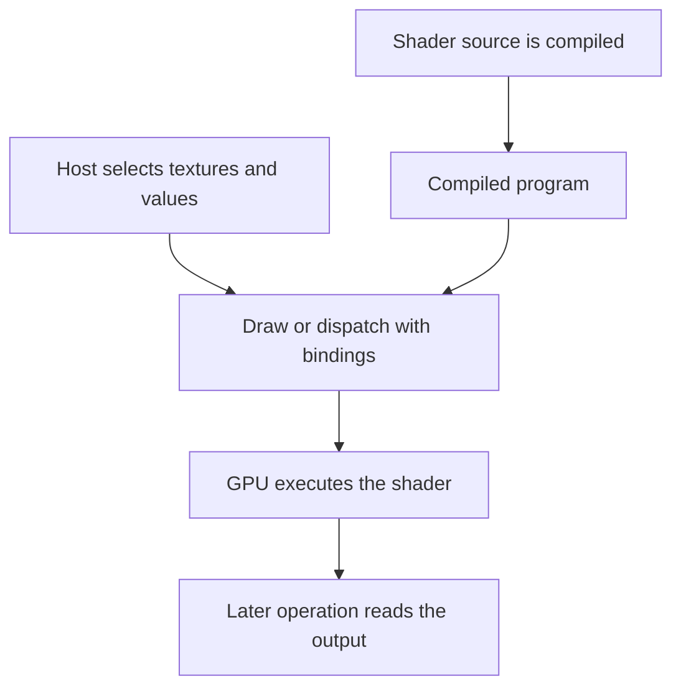

---
# Copyright 2026 Sayak Mukhopadhyay
#
# Licensed under the Apache License, Version 2.0 (the "License");
# you may not use this file except in compliance with the License.
# You may obtain a copy of the License at
#
#     https://www.apache.org/licenses/LICENSE-2.0
#
# Unless required by applicable law or agreed to in writing, software
# distributed under the License is distributed on an "AS IS" BASIS,
# WITHOUT WARRANTIES OR CONDITIONS OF ANY KIND, either express or implied.
# See the License for the specific language governing permissions and
# limitations under the License.

id: "05-01"
course: ue584
title: "Shader stages resources and bindings"
description: "Follow how host code supplies work and resources to GPU shaders."
---

Required foundations: 03-04 CPU GPU overlap resources and fences *(not published in this preview)* · 04-04 Rasterization interpolation and texture sampling *(not published in this preview)* These are guidance links; this lesson is always accessible.
## Summary
We want to read an image and write a changed image. The calculation could be as small as `1-c` for a color `c`. Writing that expression in HLSL is easy. The more interesting question is how the GPU receives the input image, gets asked to run the program, and makes its result available.

Let us arrange the same image operation in two ways. The comparison will introduce shader stages and resource bindings through jobs we actually need them to perform.
## Let a triangle create the work
One way to process an image is to draw geometry covering an output viewport. The vertex shader supplies the projected positions for that geometry. Rasterization determines the covered samples and interpolates attributes such as texture coordinates. The pixel shader receives those attributes, reads the input image, and returns an output for a bound render target.

The pixel shader does not need to manufacture its own grid of work. Drawing the geometry and rasterizing it create the relevant fragments. This is useful for full-screen image operations as well as for drawing scene surfaces.

Notice what happened around the small color expression. The host selected shaders and a render target, prepared the input texture and sampler, and submitted a draw. The GPU then used the graphics pipeline to produce and shade fragments. A shader file alone did not arrange any of this.
## Ask for an explicit grid instead
A second approach asks for compute work over the output image. A compute shader receives invocation IDs from a dispatched grid and uses them to decide which element to process. It can read an input texture and write a separate writable texture directly, without rasterizing a triangle.

The arithmetic can be identical to the pixel version. The surrounding work is different: the host submits a dispatch, the shader establishes its coordinate mapping, and the output is a writable resource rather than a pixel shader's render-target attachment. The next lesson will calculate the dispatch grid in detail.

Vertex, pixel, and compute shaders are therefore names for different ways a GPU program participates in submitted work. There are other stages and specialized pipelines, but these three are enough to understand the image-processing path we are building.
## Give each declared input a real image
Suppose the compute shader declares an input texture named `InputTexture`. The declaration says what the shader expects. It does not choose which image this particular dispatch should read. The host must connect the declaration to an actual resource. That connection is called a *binding*.

We also need to say how the shader accesses the resource. A shader resource view, commonly abbreviated SRV, gives it a reading view of a resource. A UAV—unordered access view—provides an appropriate writable view. These views describe access; they do not make arbitrary overlapping reads and writes safe.

For our simple operation, use a readable input texture and a different writable output texture. Supply their valid dimensions as small constant parameters. If we use integer texture loads, no sampler is needed. If we read at normalized coordinates with filtering, a sampler must specify the filter and addressing behavior.

This is where a correct expression can still receive the wrong information. The shader may read yesterday's image, a texture with different dimensions, or an encoded color value where it expects linear light. The compiler can accept the expression in all of these cases. Correct bindings must carry the intended data.
## Follow the result beyond its write
After the shader writes the output, some later operation must use that output. It might display it, filter it again, or copy it for inspection. If no useful operation reads it, the shader can be perfectly valid and still contribute nothing to the image you see. Unreal's render graph can also remove unused work; we will study that in module 07.

We can now describe the whole operation: select a compiled program, prepare readable and writable resources, supply dimensions and other values, submit the draw or dispatch, then use the result. Compilation and execution are separate parts of that story.

A C++ shader class belongs on the host side. It helps Unreal identify and prepare the GPU program. A breakpoint in that preparation code can show which texture and scalar were selected, but it is not a breakpoint inside every GPU invocation.

## Practical lab
This is a read-only source exercise. We will use the existing downsample operation to identify how a pixel shader and a compute shader receive their outputs. You do not need to implement the invert example or run Unreal.

1. Open baseline `Engine/Source/Runtime/Renderer/Private/PostProcess/PostProcessDownsample.cpp`. Find `class FDownsamplePS` and its `FParameters`. Write `pixel output: RENDER_TARGET_BINDING_SLOTS()`. Below it, find `class FDownsampleCS` and write `compute output: OutComputeTexture, an RWTexture2D<float4> UAV`. These are declarations of how output will be supplied, not allocations of image storage.
2. In that same file, find `PassParameters->RenderTargets[0] = Output.GetRenderTargetBinding()` inside `AddDownsamplePass`. Then find `PassParameters->OutComputeTexture = GraphBuilder.CreateUAV(Output.Texture)` inside `AddDownsampleComputePass`. Add these as the resource-selection step for each output. Both refer to the output selected by C++, through different binding mechanisms.
3. Find the two `IMPLEMENT_GLOBAL_SHADER` lines. Record `FDownsamplePS → MainPS → SF_Pixel` and `FDownsampleCS → MainCS → SF_Compute`. Both registrations name the same shader file, but select different functions and stages.
4. Find `GetDownsampleParameters`. Record the two assignments `InputTexture = Input.TextureSRV` and `InputSampler = ...SF_Bilinear...`. The texture assignment selects the image; the sampler assignment selects how sampled reads filter and address it. The shared parameters are used by both shader paths.
5. Finish your comparison with the work requests in this file: the pixel path calls `FPixelShaderUtils::AddFullscreenPass`; the compute path calls `FComputeShaderUtils::AddPass`. At this stage, identify these calls as the places C++ adds the rendering work. Module 07 explains when their recorded work executes.

**You are finished when** you have a two-column PS/CS table with four rows: entry point, output declaration, output assignment, and work-request call. You should be able to explain why declaring `OutComputeTexture` alone neither chooses a texture nor dispatches GPU work.

What is still missing after an output declaration?

The host must select a real resource, add the work using that binding, and connect the result to a later consumer. A declaration provides none of those actions by itself.

## Checkpoint
Explain how a pixel shader and a compute shader could implement the same image calculation while receiving their work differently. Then point to the actual input, writable output, and execution request in one baseline implementation.
## Sources
- [class FDownsamplePS in the pinned baseline](https://github.com/EpicGames/UnrealEngine/blob/f45729c0b6f097038e72b52d366a62baeca3275b/Engine/Source/Runtime/Renderer/Private/PostProcess/PostProcessDownsample.cpp#L42-L59)
- [class FDownsampleCS in the pinned baseline](https://github.com/EpicGames/UnrealEngine/blob/f45729c0b6f097038e72b52d366a62baeca3275b/Engine/Source/Runtime/Renderer/Private/PostProcess/PostProcessDownsample.cpp#L63-L83)
- [Microsoft HLSL programming guide](https://learn.microsoft.com/en-us/windows/win32/direct3dhlsl/dx-graphics-hlsl-pguide)
## Related
Course glossary *(not published in this preview)* · Progress and resume record *(not published in this preview)*
